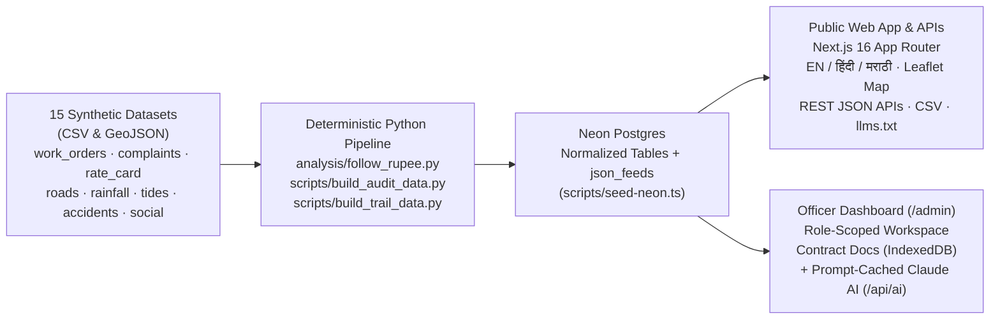
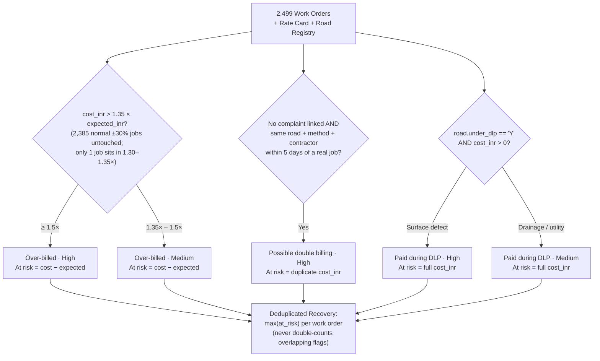
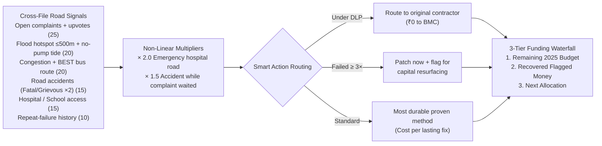
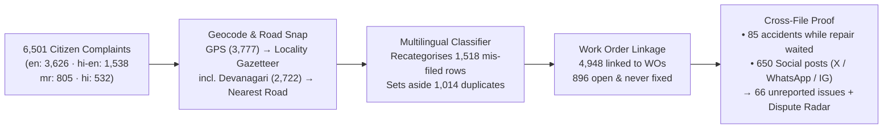

# Follow the Rupee

> **Every Mumbai monsoon road-repair rupee, traced from citizen complaint to repair outcome — with fair contractor accountability and a next-rupee budget plan.**  
> Built in [`team41/`](team41/) with **Next.js 16 · React 19 · Leaflet · Neon Postgres · Python Analytics · Claude AI**.
>
> **Live app:** [https://followtherupee.vercel.app](https://followtherupee.vercel.app)

> [!NOTE]
> **Synthetic Data Disclaimer:** This project is an audit simulation built on 100% synthetic hackathon data (`team41/data/`). All contractors, work orders, complaints, social posts, and notices are fictional and exist solely to demonstrate the audit workflow.

---

## Citywide Findings at a Glance

| Dimension | Verified Result | Why It Matters |
|---|---:|---|
| **Monsoon Spend vs. Budget** | **₹13.43 cr / ₹14.91 cr** | Across **24 BMC wards**, **2,499 work orders**, and **8 contractors** |
| **Flagged Bills (Recoverable)** | **623 jobs · ₹3.77 cr** | **493** Paid during DLP (₹2.62 cr) · **113** Over-billed (₹60.6L) · **45** Possible double billing (₹25.9L) |
| **Normal Variation Protected** | **2,385 jobs unflagged** | Jobs within ±30% of rate card, plus missed SLAs & failed fixes, are *not* mislabelled as fraud |
| **30-Day Failed Fixes** | **611 jobs · ₹3.07 cr** | Tracked by repair method to compute true **cost per lasting fix** |
| **Citizen Trail Connected** | **6,501 complaints** | Multilingual (`en`, `hi-en`, `mr`, `hi`) — **4,948** linked to WOs · **896** open & unfixed · **1,014** duplicates |
| **Human & Weather Impact** | **85 pending accidents** | **3 Fatal, 27 Grievous** while repairs waited · **44** dry-day rain excuses (< 15 mm) · **12** tide-sensitive hotspots with no pump |

---

## System Architecture & Data Flow

All auditing, indirect standardisation, complaint linking, and risk math run **deterministically in Python** and are persisted to **Neon Postgres**. Claude sits *on top* of verified JSON — explaining, summarising, and prioritising without ever inventing a rupee figure.



---

## How We Address All 5 Judging Criteria

### 1. Audit Accuracy (25%) — *Catches real problems, not normal variation*

Normal monsoon repairs naturally vary **20–30%** around standard rates. In [`analysis/follow_rupee.py`](team41/analysis/follow_rupee.py) and [`app/audit/`](team41/app/audit/AuditDetails.tsx), we separate true anomalies from normal noise with transparent thresholds, confidence tiers (**428 High · 223 Medium**), and zero double-counting:



- **Explicitly Not Flagged as Fraud:** On `/audit`, we publish the price-ratio histogram and openly show what is *excluded* from fraud flags — **2,385** normal-band bills, **1,259** missed deadlines, and **611** failed repairs (which belong on performance scorecards, not billing-fraud lists).
- **Dry-Day Rain Excuse Detector:** Cross-checks `"Rain delayed"` remarks against Santacruz & Colaba daily rainfall, isolating **44** late jobs where peak rainfall across the entire job window was **< 15 mm**.

---

### 2. Fair Accountability (20%) — *Evidence-based, no blame without context*

Raw SLA or 30-day failure rates unfairly punish contractors assigned to flood-prone wards during IMD Orange/Red rain weeks. Our scoring engine ([`follow_rupee.py`](team41/analysis/follow_rupee.py), [`build_audit_data.py`](team41/scripts/build_audit_data.py), and [`/contractors`](team41/app/contractors/ContractorsView.tsx)) uses **Indirect Standardisation**:

1. **Condition-Adjusted Expected Baseline:** Every job is benchmarked against the citywide mean within its exact `(repair_method, low_lying_band, heavy_rain_after)` cell for 30-day reopens, and `(work_type, heavy_rain_after, low_lying_band)` for SLA compliance (`heavy_rain_after` = `≥ 64.5 mm` IMD Heavy rain within 7 days of completion).
2. **Transparent A–D Grading Formula:**
   - **Durability vs. expected** (`±5 pp` → `+2 / −2` pts) — weighted double because a failed fix gets paid for twice.
   - **Speed (SLA) vs. expected** (`±5 pp` → `+1 / −1` pts).
   - **Billing discipline** (`> 5%` over-billed/double-billed jobs → `−2` pts; `> 1%` → `−1` pt).
   - **Fairness Guardrail:** **DLP payments are NOT penalised against contractors** — deciding to pay during warranty is BMC's administrative failure, not the contractor's billing error.
3. **Ward Workload Context:** Surfaces **jobs per engineering crew** vs. city average (`r = −0.56` correlation between crew overload and SLA compliance), preventing unfair blame on understaffed wards.
4. **Evidence-Backed Action:** Side-by-side comparison of up to 4 contractors, top 5 linked `work_order_id` evidence records, citizen **Endorse for my ward** control, and a simulated **Show Cause Notice** generator ([`ClawbackNoticeModal.tsx`](team41/app/map/ClawbackNoticeModal.tsx)).

---

### 3. Budget Smarts (20%) — *A next-rupee plan that makes sense*

In [`/plan`](team41/app/plan/page.tsx) and [`PlanBoard`](team41/components/plan-board.tsx), every ward gets a ranked, interactive repair plan driven by risk multipliers, method durability, and a funding waterfall:



- **Cost per Lasting Fix:** Compares repair methods by `avg_cost ÷ (1 − 30-day fail_pct)` — e.g., **Cold mix** (₹12.5k avg, 32% fail → **₹18.5k/lasting fix**) vs. **Hot mix** (₹16.8k, 23% fail → **₹21.7k**), and recommends more durable methods on ambulance and flood-prone roads where re-failure costs more than rupees.
- **Interactive What-If Budget Slider:** Officers drag a live budget slider on `/plan` to see remaining budget (green) + recoverable clawback money (blue) vs. plan cost, with a live **"Budget runs out here"** cutoff across ranked roads and a citywide **"Which wards are short?"** breakdown.

---

### 4. Connects the Trail (15%) — *Complaints to issues to work orders*

Citizens report issues in English, Hinglish, Marathi, and Hindi — often with missing wards, vague categories (~18% mis-filed), or duplicates. Our pipeline ([`follow_rupee.py`](team41/analysis/follow_rupee.py) & [`build_trail_data.py`](team41/scripts/build_trail_data.py)) reconstructs the full end-to-end chain:



- **Compound Flood & Tide Proof:** Joins `rainfall_daily.csv`, `tides.csv` (`≥ 4.5 m` big tides), and `flood_hotspots.csv` — showing waterlogging complaints jump from **9.1/day** (dry) → **26.7/day** (heavy rain) → **38.5/day** (heavy rain + big tide).
- **Social Dispute Radar:** Filters 650 social posts into `report` (271), `sarcasm` (46), `thanks` (57), and `noise` (276), surfacing **66 unreported locality issues** and flagging completed repairs disputed on WhatsApp/X afterward.

---

### 5. Usable + Demo (20%) — *Built for real action by citizens and ward officers*

| User | Key Flows | Actionable Output |
|---|---|---|
| **Citizens** | `/` · `/map` · `/track` · `/ward/[code]` | Switch language (**EN / हिंदी / मराठी**), search any complaint ID, work order, road, or ward in `/track` to inspect a **5-stage visual timeline** (`Complaint → Assigned → Work started → Repaired → 30 days later`), explore 5 map layers, and endorse strong contractors. |
| **Ward Officers & BMC Admins** | `/admin` · `/audit` · `/plan` · `/contractors` | Sign in to a role-scoped dashboard (`/admin/login`), track contracts with **PDF/image document uploads** (IndexedDB), advance open complaints across 5 stages, simulate budgets, download `/audit/flags.csv`, copy formatted **Show Cause Notices**, and run one-click or Q&A briefings with the **streaming Claude AI Assistant** (`POST /api/ai`). |
| **Auditors & AI Agents** | `/api/*` · `/llms.txt` · `/sitemap.xml` | Query 5 zero-auth JSON APIs (`/api/wards`, `/api/work-orders`, `/api/complaints`, `/api/audit-flags`, `/api/health`) and on-demand GeoJSON point layers (`/map/points/[layer]`). |

---

## Complete Feature & Route Map

| Route / Endpoint | What It Does |
|---|---|
| [`/`](team41/app/page.tsx) | Landing overview with Mumbai city sketch hero, citywide stats, and trilingual switcher (`EN / हिंदी / मराठी`) |
| [`/map`](team41/app/map/page.tsx) | Full-screen Leaflet ward map + universal search bar + KPI ticker + **5 lazy-loaded toggle layers** (`Roads`, `Complaints`, `Accidents`, `Flood spots`, `Schools & hospitals`) fetched from Postgres via [`/map/points/[layer]`](team41/app/map/points/%5Blayer%5D/route.ts) |
| [`/audit`](team41/app/audit/page.tsx) | Visual wasted-money charts (by reason, ward, month, contractor), normal-variation cost histogram, plain-language bill story cards, excluded-from-fraud disclosure, and CSV export at [`/audit/flags.csv`](team41/app/audit/flags.csv/route.ts) |
| [`/plan`](team41/app/plan/page.tsx) | Clickable ward map + live **what-if budget slider**, ranked risk roads, method durability economics, and citywide shortfall list |
| [`/contractors`](team41/app/contractors/page.tsx) | Condition-adjusted A–D report cards, side-by-side comparison (up to 4 contractors with diff-only filter), evidence links, and citizen endorsements |
| [`/track`](team41/app/track/page.tsx) | Citizen complaint & work-order lookup with 6 one-click real story examples and a 5-stage repair timeline |
| [`/ward/[code]`](team41/app/ward/%5Bcode%5D/page.tsx) | Dedicated deep-dive page for all 24 wards (e.g., `/ward/F-S`): weekly officer action list, fair report card, complaint-to-repair funnel, pending accidents, dry-day rain excuses, flood hotspots, social posts, and ward CSV export |
| [`/admin`](team41/app/admin/page.tsx) | Authenticated officer portal with ward switcher, contract + document manager, 5-stage complaint board, and prompt-cached streaming **Claude AI Analyst** ([`/api/ai`](team41/app/api/ai/route.ts)) |
| [`/api/*`](team41/app/api/) & [`llms.txt`](team41/public/llms.txt) | Public JSON APIs (`wards`, `work-orders`, `complaints`, `audit-flags`, `health`), `robots.txt`, dynamic `sitemap.xml`, and agent-readable `llms.txt` |

---

## Why This Is the Best Solution

1. **Deterministic Math + Grounded AI:** Every flag, expected baseline, and rupee calculation is reproducible Python stored in Postgres; Claude only interprets verified JSON (with prompt caching and prompt-injection guardrails) — zero hallucinated numbers.
2. **Surgical Precision, Zero False Blame:** Proves the boundary between normal 20–30% rate variance and real overbilling (`> 1.35×`), separates BMC's DLP errors from contractor grades, and controls for flood terrain, heavy rain, and crew overload.
3. **Connects Rupees to Real Human Risk:** Joins billing data directly to **85 pending-repair accidents**, **17 emergency hospital roads**, and **tide-compounded flood hotspots** so budgets follow both money and lives.
4. **Closes the Recovery-to-Repair Loop:** Turns audit findings directly into funding — showing exactly how recovered DLP/overbilling money pays for the highest-risk unfixed roads in each ward.
5. **Production-Grade Usability:** Live Neon Postgres backend, lazy-loaded map layers, trilingual citizen UI, open REST APIs, CSV exports, and an interactive officer workspace ready to demo end-to-end.

---

## Quick Start

All application code lives in [`team41/`](team41/):

```bash
cd Project/claude-hackathon-2026/team41

# 1. Install dependencies
npm install

# 2. (Optional) Regenerate analysis feeds from CSVs
python analysis/follow_rupee.py
python scripts/build_audit_data.py
python scripts/build_trail_data.py

# 3. Seed Neon Postgres (requires DB_URL in .env)
npm run db:seed

# 4. Run the development server
npm run dev
```

Open `http://localhost:3000`.  
To test the officer dashboard at `/admin`, configure `ANTHROPIC_API_KEY` and `ADMIN_SECRET` in `team41/.env` (demo credentials in [`lib/auth.ts`](team41/lib/auth.ts): `admin` / `test123`).
